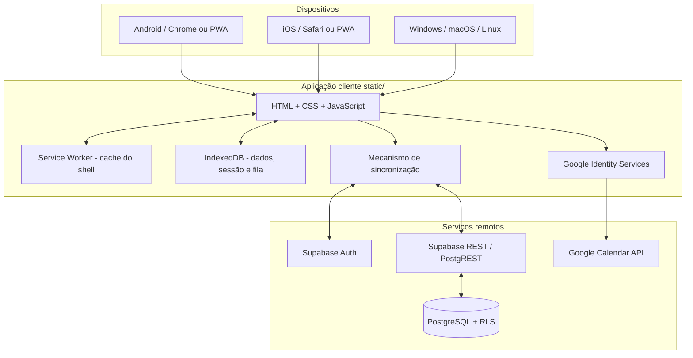

# Arquitetura técnica — Disciplina (MVP 0.2)

**Estado:** arquitetura implementada/proposta para teste pessoal. **Fuso:** `America/Sao_Paulo`.

## 1. Objetivo e escopo

Disciplina é uma aplicação de organização e acompanhamento pessoal. O calendário representa o planejado; os registros de execução representam o realizado. Atividades do cronograma (`scheduled`) e atividades extraordinárias (`extra`) permanecem separadas nos indicadores.

O MVP contempla agenda e status de tarefas; sessões de produção com duração, resultado e próximo passo; banco de ideias; metas semanais/mensais; diário; dashboard; importação e atualização de eventos do Google Calendar; e uso offline após a primeira autenticação e carga online. A fase atual é pessoal e experimental: há estrutura multiusuário e isolamento por conta, mas ainda não está pronta para cadastro público.

## 2. Princípios

1. Universalidade: uma aplicação web responsiva para navegadores móveis e desktop.
2. PWA: instalação pelo navegador, sem APK/IPA nesta fase.
3. Offline-first: gravação local imediata e sincronização quando possível.
4. Cloud-backed: Supabase é a fonte compartilhada entre dispositivos.
5. Privacidade: cada registro tem `user_id`; RLS valida `auth.uid() = user_id`.
6. Google Calendar é integração opcional, não o banco principal das tarefas.
7. Evolução incremental: validar uso real antes de preparar distribuição pública.

## 3. Diagrama lógico

## 4. Componentes

### Frontend (`static/`)
- `index.html`: telas, formulários, navegação.
- `style.css`: identidade dark e layout responsivo.
- `app.js`: estado da interface, regras do MVP, autenticação, IndexedDB, sincronização e Google Calendar.
- `config.js`: URL Supabase e chave pública `anon`/`publishable`; não colocar segredos.
- `manifest.webmanifest`: nome, ícone e modo de exibição PWA.
- `sw.js`: cache dos recursos essenciais.
- `icons/icon.svg`: ícone.

O frontend é estático; não depende de servidor Python no computador pessoal.

### PWA e offline
O Service Worker mantém em cache os recursos essenciais para reabrir a aplicação sem rede. IndexedDB contém stores `tasks`, `logs`, `ideas`, `goals`, `journal`, `queue` (alterações ainda não confirmadas) e `meta` (sessão e metadados).

O primeiro login e a primeira carga precisam ocorrer online. Depois, dados já carregados ficam disponíveis localmente. O navegador pode remover armazenamento se o usuário apagar os dados do site ou sob pressão de espaço; a nuvem continua sendo a cópia compartilhada.

### Supabase
Supabase fornece Auth, PostgreSQL, PostgREST e Row Level Security. Não há API FastAPI própria nesta versão; isso reduz a infraestrutura operacional do teste pessoal. Um backend próprio poderá ser introduzido quando houver necessidade de lógica server-side ou integrações adicionais.

### Google Calendar
A integração usa Google Identity Services no navegador e Google Calendar API diretamente. Requer OAuth Client ID do tipo Web application e escopo `https://www.googleapis.com/auth/calendar.events`. Importa eventos da agenda principal em janela móvel de 30 dias anteriores e 120 dias futuros. Eventos são associados por `google_event_id`. O access token fica em memória, não persistido; pode ser necessário autorizar novamente em outra sessão.

A sincronização atual é parcial: exclusões remotas, exceções complexas de recorrência, notificações push e renovação server-side ainda não estão implementadas.

## 5. Modelo de dados

Todas as tabelas têm `id` UUID, `user_id` referenciando `auth.users(id)` e timestamps.

| Tabela | Finalidade | Campos principais |
|---|---|---|
| `tasks` | Agenda e execução | `title`, `category`, `task_date`, `start_at`, `end_at`, `status`, `kind`, `source`, `google_event_id` |
| `logs` | Sessões de produção | `log_date`, `category`, `duration_minutes`, `activity`, `result`, `next_step` |
| `ideas` | Ideias e notas | `idea_date`, `category`, `title`, `content` |
| `goals` | Metas | `title`, `category`, `target`, `unit`, `period`, `active` |
| `journal` | Fechamento diário | `journal_date`, `done`, `obstacles`, `tomorrow` |

Estados: `pending`, `in_progress`, `done`, `partial`, `skipped`. Classificação: `kind=scheduled` ou `extra`; origem: `source=manual` ou `google`. `supabase/schema.sql` define tabelas, índices, gatilho `updated_at`, permissões e RLS.

## 6. Fluxos

### Gravação offline-first
1. Usuário cria/edita registro.
2. Cliente atribui UUID e `user_id`.
3. Registro é persistido no IndexedDB.
4. Alteração entra na fila `queue`.
5. Interface atualiza imediatamente.
6. Se houver rede e sessão válida, a fila é enviada ao Supabase.
7. Após confirmação, o item sai da fila.

### Sincronização entre dispositivos
1. Usuário autentica.
2. App carrega cache local.
3. Com internet, envia alterações pendentes.
4. Consulta dados remotos do usuário autenticado.
5. Atualiza cache local.
6. Outros dispositivos repetem o fluxo.

Conflitos: o MVP usa `updated_at`, prioriza alterações locais pendentes e adota uma estratégia simplificada de última gravação vence. Não é um protocolo robusto de resolução de conflitos. Evitar editar simultaneamente o mesmo registro em dois dispositivos durante os testes.

### Google Calendar
1. Usuário informa OAuth Client ID.
2. App solicita token ao Google Identity Services.
3. Usuário concede permissão.
4. Cliente importa/atualiza eventos locais.
5. Edições são enviadas à API enquanto o token é válido.
6. Se offline, alterações ficam pendentes até reconexão e eventual nova autorização.

## 7. Segurança e privacidade

- A chave `anon`/publishable é pública por desenho; RLS é essencial.
- Nunca colocar `service_role`, client secret OAuth ou segredo privilegiado em `config.js`, GitHub público ou código cliente.
- RLS deve permanecer habilitado em todas as tabelas pessoais.
- O banco valida `auth.uid() = user_id`.
- Sessão Supabase fica no IndexedDB do navegador; token Google fica em memória.
- Usar HTTPS fora do desenvolvimento local.
- Para teste pessoal, fechar novos cadastros depois de criar a conta, se a configuração do Supabase permitir.
- Não inserir informações altamente sensíveis no MVP experimental.

## 8. Implantação

### Desenvolvimento local
Servir `static/` por servidor HTTP local. Service Worker e instalação PWA funcionam em `localhost`; autenticação/sincronização exigem Supabase configurado.

### Teste pessoal
Hospedagem estática HTTPS (Netlify é o caminho documentado), Supabase para Auth/banco e Google Cloud para OAuth/Calendar. Um domínio Netlify é suficiente.

### GitHub
Repositório privado durante a validação. Antes do push, revisar configuração, garantir ausência de segredos, manter `.gitignore` e não versionar tokens, senhas ou exportações de dados pessoais.

### Publicação futura
Revisar segurança, política de privacidade, termos, recuperação de conta, limitação de abuso, monitoramento, backups/restauração, testes automatizados, acessibilidade, conflitos offline e sincronização robusta do calendário.

## 9. Limitações conhecidas

1. PWA, não APK/IPA nativa.
2. Primeiro acesso em cada dispositivo exige internet e autenticação.
3. Offline depende de cache e IndexedDB preservados pelo navegador.
4. Resolução de conflitos é simplificada.
5. Google Calendar não tem sincronização bidirecional completa nem renovação server-side.
6. Eventos recorrentes complexos e exclusões remotas precisam de refinamento.
7. Notificações push e tarefas em segundo plano não fazem parte desta versão.
8. Não há painel administrativo nem onboarding público.
9. O dashboard usa os registros existentes; não infere execução de tarefas sem atualização de status.

## 10. Critérios de validação pessoal

- Criar conta e entrar.
- Instalar PWA no Android.
- Fechar/reabrir e verificar persistência.
- Criar, editar e concluir tarefas online.
- Ativar modo avião e criar/editar registros.
- Fechar/reabrir ainda offline.
- Recuperar conexão e verificar sincronização.
- Entrar com a mesma conta em outro dispositivo e conferir os dados.
- Conectar Calendar, importar evento e testar atualização.
- Confirmar separação entre tarefas programadas e extras.

## 11. Evolução

**A — teste pessoal:** corrigir UX, sincronização, instalação e importação observadas no uso real.

**B — robustez:** testes automatizados, migrações SQL versionadas, conflitos, tombstones, logs de sincronização, backup e recuperação.

**C — produto publicável:** onboarding, recuperação de senha, documentos legais, acessibilidade, telemetria consentida, proteção contra abuso e suporte.

**D — distribuição nativa opcional:** avaliar Capacitor para Android/iOS e Tauri para desktop, mantendo frontend e API compartilhados.
